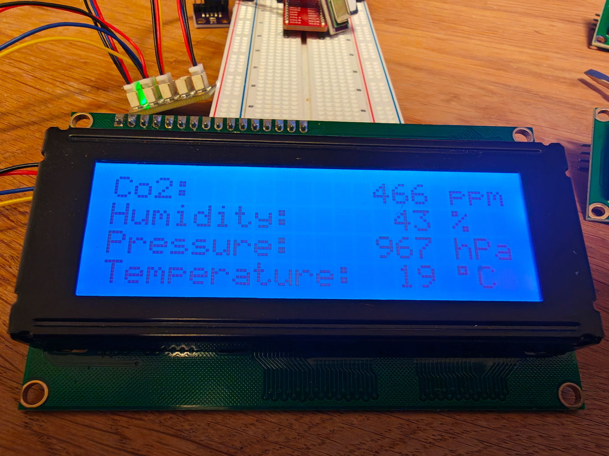

# HomeAssistant Pi4J Sensor Wireup Example



A simple REST server that reports the measurements for all 
auto-detected I2C sensors as a simple JSON object.

## Hardware Setup

Connect any available I2C sensor(s) and a HD44780+PCF8574 based 20x4 LCD to I2C bus 1
(Pins 1-3 for power, SDA and SCL and pin 6 for Ground).

## Example Code

- SensorServer.java: Provides sensor values in JSON format (compatible with HomeAssistant) via a tiny
  HTTP server

- SensorServer2004App.java: Additionally renders the values on a 20x4 LCD 

- TinyWebServer: A tiny utility implementing a server socket HomeAssitant can connect to.

## Usage

When started, the server will print intstructions how to use it, similar to this:

```
Sensors found:
[com.pi4j.drivers.sensor.environment.bmx280.Bmx280Driver@b7dd107, com.pi4j.drivers.sensor.environment.scd4x.Scd4xDriver@42eca56e]
Reading initial sensor values...
Initial sensor values aquired: {co2=688.0, humidity=45.828508377075195, pressure=96775.5, temperature=22.101489067077637}

Webserver started at http://192.168.178.197:8147

Pi4J I2C Autodetect Sensor Server

HomeAssistant YAML
configuration snippet: http://192.168.178.197:8147/config
Measurements:          http://192.168.178.197:8147/measurements

This help text:        http://192.168.178.197:8147

```
