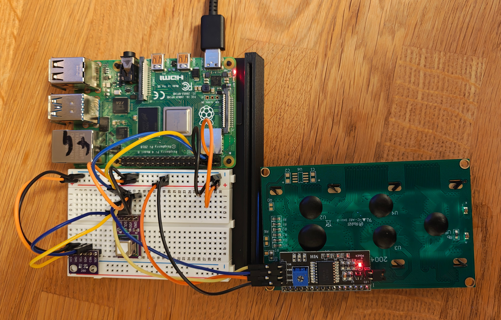
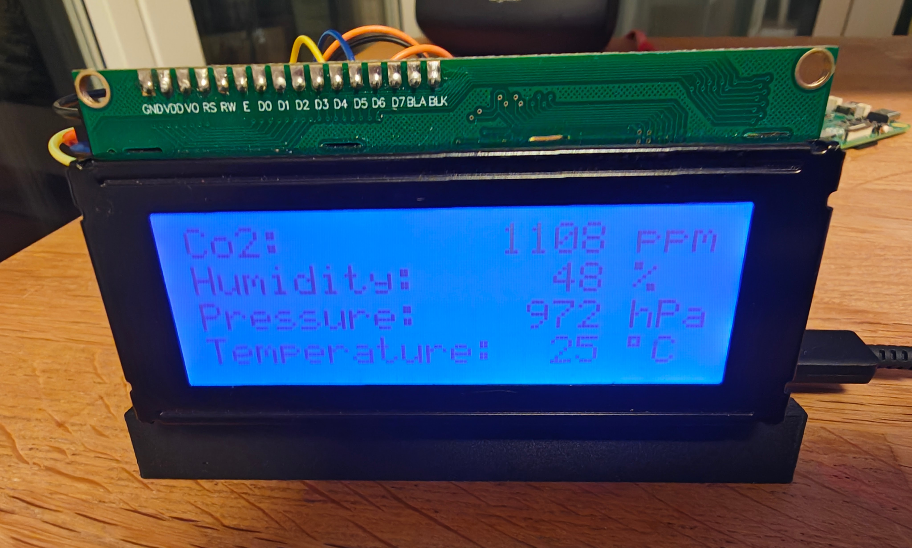

# HomeAssistant Pi4J Sensor Server Example

A simple REST server that reports the measurements for all 
auto-detected I2C sensors as a simple JSON object.

## Hardware Setup

Connect any available I2C sensor(s) and a HD44780+PCF8574 based 20x4 LCD to I2C bus 1
(Pins 1-3 for power, SDA and SCL and pin 6 for Ground), as shown in the picture below.




The CAD file for the open case can be found here: [breadboard-2004-open-pi-case](https://www.tinkercad.com/things/03pwEHJODWy-breadboard-2004-open-pi-case)

## The Example Code

The example code consists of the following files:

- SensorServer.java: Provides sensor values in JSON format (compatible with HomeAssistant) via a tiny
  HTTP server

- SensorServer2004App.java: Additionally renders the values on a 20x4 LCD (it should be straight forward to adapt this 
  code to use a different display)

- TinyWebServer: A tiny utility implementing a server socket HomeAssitant can connect to.

## Running the Server

If not already done, please follow the general example setup instructions in 
the [main README](../../../../../../../../README.md#setup) file.

After these steps, a headless server can be started from the pi4j-examples directory unsing the following maven
command:

```
mvn exec:java -Dexec.mainClass="com.pi4j.examples.sensor.homeassistant.SensorServer"
```

Alternatively, connect a 20x4 LCD to the Pi4J I2C bus and start the server with the following command:

```
mvn exec:java -Dexec.mainClass="com.pi4j.examples.sensor.homeassistant.SensorServer2004App"
```

When started, the server will print instructions on how to use it, similar to this:

```
Sensors found:
[com.pi4j.drivers.sensor.environment.bmx280.Bmx280Driver@b7dd107, com.pi4j.drivers.sensor.environment.scd4x.Scd4xDriver@42eca56e]
Reading initial sensor values...
Initial sensor values aquired: {co2=688.0, humidity=45.828508377075195, pressure=96775.5, temperature=22.101489067077637}

Webserver started at http://192.168.178.197:8147

Pi4J I2C Autodetect Sensor Server

HomeAssistant YAML
configuration snippet: http://192.168.178.197:8147/config
Measurements:          http://192.168.178.197:8147/measurements

This help text:        http://192.168.178.197:8147
```

The "2004" server will additionally render the sensor values on a 20x4 LCD, as shown in the image below.



## Home Assistant Integration

To integrate the server with Home Assistant, you can use the configuration snippet provided by the server. 

View the URL from the "configuration snippet" line in a browser and paste the content it into your 
Home Assistant `config.yaml` file in the `rest:` section (which might need to be added if it does not exist already). 

This will allow Home Assistant to connect to the server and retrieve sensor data. A rest integraton should
appear automatically in Home Assistant, and it should provide a debug logging option, which comes quite
handy if anything goes wrong.

Unfortunately, resolving host names in the local network seemed unreliable in HomeAssistant. It's probably best to
assign a fixed IP address locally or in the router, so this won't change after a reboot.